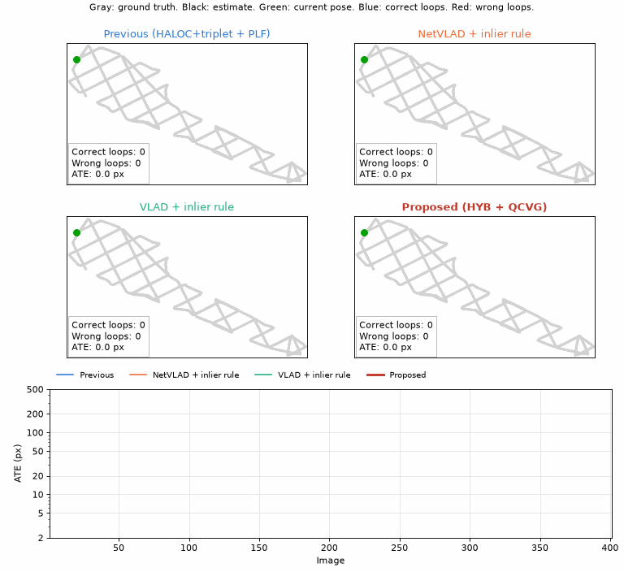

# OVLOOP: Aliasing-Aware Visual Graph SLAM for Underwater Robots

OVLOOP (OVerlap-supervised LOOP closing) is a complete visual Graph SLAM for Autonomous Underwater Vehicles endowed with a bottom-looking camera, robust in front of turbidity and perceptual aliasing.

This repository provides an on-line visual Graph SLAM in which loop retrieval, geometric verification and loop validation are designed together. Loop candidates are retrieved by fusing a hand-crafted VLAD descriptor with a learned image embedding, verified by RANSAC with a metric rigid model that exploits the altimeter and validated by Query-level Consensus Validation with Gating (QCVG). In this way, the wrong loops produced by repetitive sea floors, which pass geometric verification with many inliers, are rejected before they corrupt the map.

The following animation compares the proposed system with three previously existing approaches on the same mission, over a sea floor that contains duplicated regions. The approaches based on the classical inlier rule accept the aliased loops (red) and distort the map, whereas our previous approach rejects them but closes few loops. Each panel shows the number of correct and wrong loops and the Absolute Trajectory Error (ATE) of the current estimate. The plot at the bottom shows how the ATE of each approach evolves as the mission advances. It can be observed that the inlier rule approaches suffer a sudden increase of the error as soon as they accept the first aliased loops, whereas the error of the proposed system decreases every time the mission revisits an area.



## Credits and citation

**Science and code**: Antoni Burguera (antoni dot burguera at uib dot es)

**Citation**: If you use this software, please cite the following paper:

- Reference to be posted soon.

## Basic usage

Check **example_slam.py** to see a usage example. The datasets used in this example are not available in this repository. Overall, using the SLAM system is as simple as:

```python
from datasimulator import DataSimulator
from hybridretriever import HybridRetriever
from imageregistrator import ImageRegistrator
from slamparameters import SLAMParameters
from slamsystem import SLAMSystem

theSimulator=DataSimulator('DATASET')
theSimulator.load()
theRetriever=HybridRetriever()
theRetriever.load('MODELS')
theRegistrator=ImageRegistrator(hOpening=theSimulator.hOpening)
theSLAM=SLAMSystem(SLAMParameters(),theRetriever,theRegistrator,theSimulator.get_ground_truth()[:,0])
while theSimulator.fetch():
    theOdometry,odoCovariance=theSimulator.get_odometry()
    theSLAM.set_input(theSimulator.get_image(),theSimulator.get_altitude(),theOdometry,odoCovariance)
    theSLAM.process()
theSLAM.optimize()
estPoses=theSLAM.get_poses()
theLoops=theSLAM.get_loops()
```

The DataSimulator is only a convenience class to make the example self-contained. To use the SLAM with your own vehicle, just call **set_input** and **process** every time a new image is grabbed, providing the image, the altimeter reading and the odometric motion from the previous image together with its covariance. Check the section **Using your own AUV** below to learn about the requirements of these inputs.

All the files are fully commented. Check the comments in each file to learn about it.

> [!IMPORTANT]
> The first time the system is used, PyTorch Hub downloads the official DINOv2 weights (about 90 MB). The repository only contains the weights of the layers that we trained, which are loaded on top of them.

## Using your own AUV

The DataSimulator only provides the data that a real AUV would provide. To use the system with your own vehicle, replace it by your sensors and take into account the following:

* **Images**: Provide the images grabbed by the bottom-looking camera as HxWx3 RGB arrays. The system assumes an ideal pinhole camera pointing straight down over a flat sea floor, described only by its horizontal opening (**hOpening** in the **ImageRegistrator** constructor). Thus, the lens distortion must be removed before providing the images. Changes in pitch and roll, as well as the relief of the sea floor, are not modelled.
* **Altitude**: Provide the altimeter (or DVL) reading at the instant each image was grabbed.
* **Odometry**: The SLAM does not compute the odometry. It has to be obtained from the navigation of the vehicle (for example, a DVL together with an IMU or a compass), integrated between the instants at which two consecutive images were grabbed and provided as a motion [x,y,o] together with its 3x3 covariance. This motion must be expressed in the reference frame of the camera at the previous image, where x is aligned with the image columns and y with the image rows. If the odometry refers to the vehicle and the camera is displaced or rotated with respect to it, the odometry must be transformed to the camera frame first. Accordingly, the estimated poses are those of the camera.
* **Units**: All the distances are expressed in world units. In the examples, they are the pixels of the photomosaic over which UCAMGEN simulates the AUV. With a real AUV, they will probably be metres. The altitude, the odometry and the parameters expressed in world units (such as **loopSigmaXY** in **SLAMParameters**) must use the same units, so the latter must be rescaled.
* **Calibration**: As explained below, **inlierThreshold** and **mapThreshold** were calibrated on simulated validation data. They should be calibrated again for your vehicle, camera and sea floor.
* **Learned models**: The embedding network and the statistics used to fuse the two similarities (see **MODELS**) were obtained from images simulated over photomosaics. They may work with real images, but it may be necessary to retrain the network or, at least, to recompute the statistics with your own data.

## Datasets

The examples use **DataSimulator** objects (see **datasimulator.py**) to access [UCAMGEN](https://github.com/aburguera/UCAMGEN) datasets. UCAMGEN simulates an AUV endowed with a bottom-looking camera moving over a photomosaic of the sea floor, and it provides the images and the ground truth. The DataSimulator adds a noisy altimeter and a noisy odometry, the default noise being that of the main experiments of the paper. Check **example_datasimulator.py** to learn how to use it.

Check the [UCAMGEN](https://github.com/aburguera/UCAMGEN) repository for information about its format and to grab the software to create your own datasets. Neither UCAMGEN nor the DataSimulator are required to perform SLAM. They are provided only to make the examples self-contained.

## Understanding the system

All the files are extensively commented. Check the comments to understand how to use the system and how it works. Additionally, check the paper referenced above. Next, the main components are described.

### SLAMSystem

The main class is **SLAMSystem** (see **slamsystem.py**). It follows a construct, set, process and get cycle. For every image provided with **set_input**, the method **process** performs five steps:

* **Odometry**: A new node is added to the pose graph using the odometry.
* **Loop retrieval**: The most similar past images, excluding the most recent ones, are selected as loop candidates by the **HybridRetriever**.
* **Geometric verification**: Each candidate is registered with the current image by the **ImageRegistrator**.
* **Loop validation**: The registered candidates are validated by QCVG, which is described below.
* **Optimization**: The accepted loops are added to the graph, which is optimized by the **PoseGraph**.

The results are obtained with **get_poses** and **get_loops**. The method **optimize** should be called at the end of the mission to perform a final optimization.

All the parameters are grouped in **SLAMParameters** (see **slamparameters.py**), and their default values are those of the paper. Two of them, **inlierThreshold** and **mapThreshold**, were calibrated on validation data. They depend on the camera, the sea floor and the odometry, so it is advisable to calibrate them again if your conditions are very different.

### Loop retrieval

The **HybridRetriever** (see **hybridretriever.py**) describes each image with two global descriptors. The first one is a hand-crafted Vector of Locally Aggregated Descriptors (**VLADDescriptor**, see **vladdescriptor.py**) built on SIFT features, which is very precise when the fine texture of the sea floor is preserved. The second one is a learned embedding (**EmbeddingNet**, see **embeddingnet.py**), which is less precise but much more robust in front of turbidity. The embedding network is a self-supervised DINOv2 backbone whose last four blocks have been trained so that images depicting overlapping regions of the sea floor have close embeddings. The two similarities are standardized and fused, so that the retrieval takes advantage of both.

### Geometric verification

The **ImageRegistrator** (see **imageregistrator.py**) extracts SIFT features after a contrast equalization, matches them and estimates the motion between the two cameras by RANSAC. Instead of the classical homography, it uses a metric rigid model with only 3 degrees of freedom. To this end, the keypoints are converted to metric units using the altitude provided by the altimeter. Thanks to that, fewer inliers are needed to reliably accept a correct loop.

### Loop validation

Repetitive sea floors produce wrong loops that pass geometric verification with as many inliers as the correct ones. QCVG rejects them by means of three tests:

* **INL**: The loop must have enough RANSAC inliers.
* **GATE**: The loop must agree with the prediction of the current map. The uncertainty of the prediction is propagated along the least uncertain path of the pose graph, and the decision threshold is calibrated instead of using the theoretical chi-square one.
* **QCV**: Two candidates a and b of the same image are consistent if the motion from a to b implied through the image agrees with the motion from a to b according to the map. The largest set of mutually consistent candidates is accepted only if it is unique and has at least two members. If a single candidate passes INL and GATE, it is accepted.

### Auxiliary code

There are some files with auxiliary classes and functions:

* **posegraph.py**: 2D pose graph optimized by a sparse Levenberg-Marquardt.
* **transform2d.py**: 2D transformations (composition, inversion, covariance propagation, ...).
* **plotutil.py**: Plotting utilities.
* **util.py**: General purpose utilities, including the Absolute Trajectory Error.

### Models

The folder **MODELS** contains the trained models used in the paper:

* **vlad_vocabulary.npy**: VLAD vocabulary (32 visual words).
* **embedding_weights.pt**: Trained parameters of the embedding network.
* **hybrid_retrieval.json**: Weight and statistics used to fuse the two similarities.

## Requirements

To execute this software, you will need:

* Python 3 (tested with Python 3.12)
* NumPy
* SciPy
* OpenCV
* PyTorch
* Pillow
* Matplotlib (only for the examples)
* scikit-learn (only to build new VLAD vocabularies)

All of them can be installed with:

```
pip install -r requirements.txt
```

## Troubleshooting

The embedding network runs on the GPU if one is available (CUDA or Apple MPS) and on the CPU otherwise. The device can be forced with the **theDevice** parameter of the **HybridRetriever** constructor. For example, **HybridRetriever('cpu')** forces the CPU, which is slower but works everywhere.

If PyTorch Hub cannot download DINOv2 (for example, due to a firewall), download it once on a computer with internet access and copy the folder **~/.cache/torch/hub** to the same place in your computer.

## Disclaimer

The code is provided as it is. It may work on your computer, it may not. It may even close a loop between your computer and an identical one somewhere else in the universe, which would be geometrically consistent but, regrettably, wrong. Use it at your own risk and, just in case, keep an eye on the red lines.
